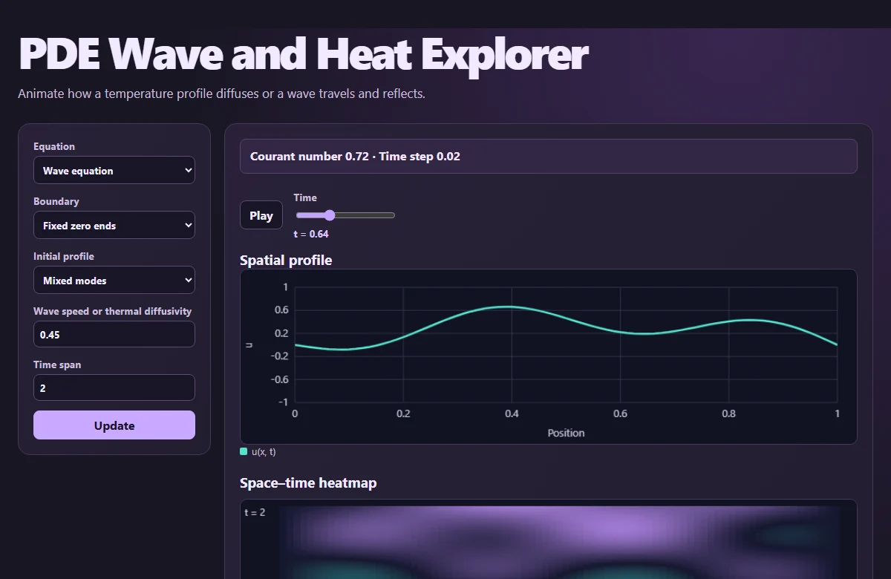

# PDE Wave and Heat Explorer

Animate how a temperature profile diffuses or a wave travels and reflects.

[Open the web app](https://surfingcoder.com/apps/pde-wave-and-heat-explorer/)



## Run locally

Serve the repository with Python 3, then open http://127.0.0.1:8000/ in a current browser.

```sh
python -m http.server 8000 --bind 127.0.0.1
```

Start with the provided example. Adjust the controls and select **Update** to recompute. Sliders refresh the result as you move them.

## Method

On [0, 1], the heat model uses uₜ = αuₓₓ and the wave model uses uₜₜ = c²uₓₓ with zero initial velocity. The finite differences use stable time steps for the selected grid and coefficient.

## Verify

Run `node --test check.mjs` with Node.js 22 or newer. The check runs the app’s mathematical regression cases without a browser.
